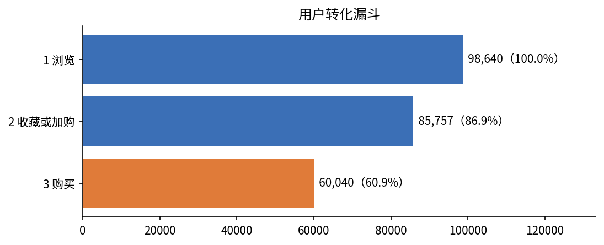
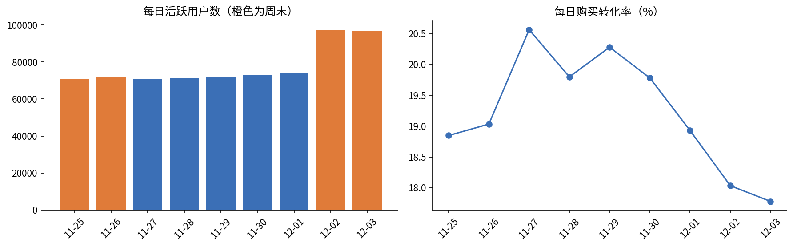
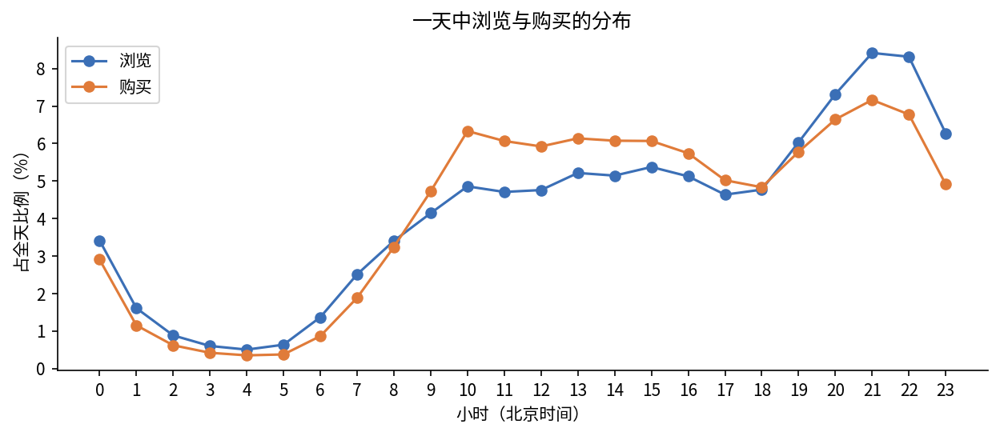
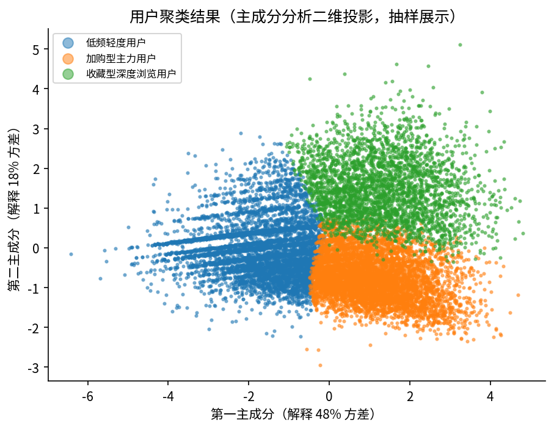
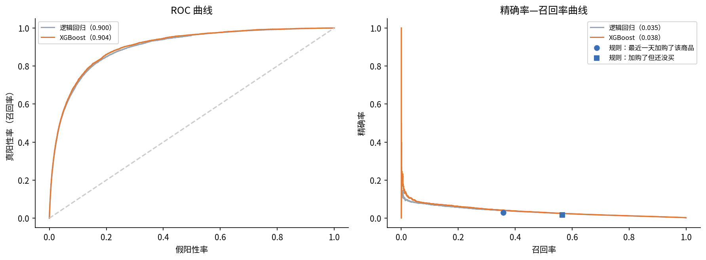
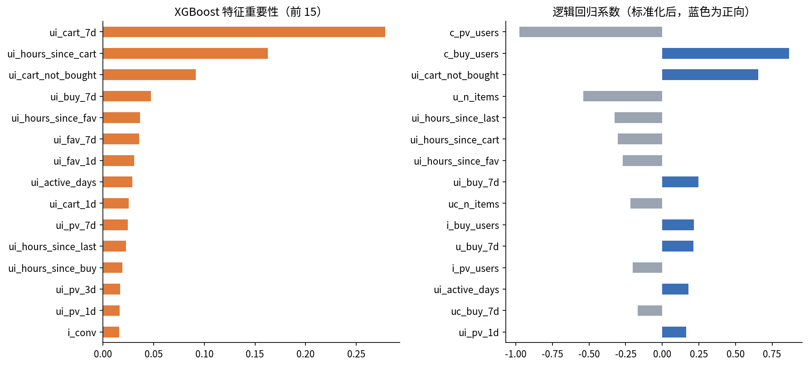

# 电商用户行为分析与购买预测

基于阿里天池淘宝用户行为数据（约 1 亿条行为记录），用 **SQL + Python** 完成从数据清洗、指标分析、用户分群到购买预测的完整分析流程。

**技术栈：** Python（pandas、scikit-learn、XGBoost、matplotlib、seaborn）· SQL（DuckDB，窗口函数、公用表表达式）· SciPy 统计检验 · Google Colab

## 项目亮点

- **大数据量处理：** 用 DuckDB 直接查询 3.5GB 原始文件，按用户抽样 10%，清洗后约 1,000 万条记录、9.9 万名用户
- **业务洞察：** 加购商品的购买率是仅浏览商品的 **2.8 倍**；双十二预热期活跃用户增加约 **35%**，购买转化率反而下降
- **用户分群：** **39.6%** 的重要价值用户贡献了 **60.6%** 的购买；K 均值聚类识别出加购型、收藏型、低频型三类用户
- **购买预测：** 用户-商品级 XGBoost 模型，测试集 ROC 曲线下面积 **0.90**，得分前 1% 的候选命中率是随机推荐的 **24.6 倍**

## 数据说明

| 项目 | 说明 |
|---|---|
| 来源 | [阿里天池：User Behavior Data from Taobao for Recommendation](https://tianchi.aliyun.com/dataset/649) |
| 时间范围 | 2017 年 11 月 25 日至 12 月 3 日（9 天） |
| 原始规模 | 100,150,807 条行为记录，约 100 万名用户 |
| 字段 | 用户编号、商品编号、类目编号、行为类型（浏览、收藏、加购、购买）、时间戳 |
| 抽样 | 按用户哈希抽样 10%，保留每个用户完整的行为序列 |
| 清洗 | 时区转换为北京时间；删除时间越界、完全重复和异常记录，共删除 5,397 条（0.05%） |
| 分析样本 | 10,010,718 条记录，99,057 名用户，159 万件商品，8,006 个类目 |

## 分析框架

| 笔记本 | 内容 | 主要方法 |
|---|---|---|
| `01_数据准备与清洗` | 数据质量检查、清洗、抽样 | DuckDB、SQL |
| `02_SQL_漏斗与留存分析` | 核心指标、转化漏斗、购买路径、留存、复购间隔、时间规律、类目分析 | SQL 窗口函数（`LAG`、`LEAD`、`MIN() OVER`）、两样本比例 Z 检验 |
| `03_用户分群_RFM与聚类` | RF 价值分层、K 均值行为聚类 | 规则分层、K 均值、轮廓系数、主成分分析、卡方检验 |
| `04_购买预测模型` | 用户级次日购买预测（基准版） | 逻辑回归、随机森林、XGBoost |
| `05_用户商品购买预测` | 用户-商品级次日购买预测（升级版） | 负样本下采样、按时间切分验证、XGBoost |

## 主要发现

### 1. 转化漏斗：加购是最强的购买信号，但多数购买不经过加购

| 环节 | 用户数 | 环节转化率 |
|---|---|---|
| 浏览 | 98,640 | — |
| 收藏或加购 | 85,757 | 86.9% |
| 购买 | 60,040 | 70.0% |

- 按行为次数看，**浏览到收藏或加购只有 9.4%**，是流失最严重的环节
- 加购过的商品购买率 **6.1%**，收藏过的 4.2%，仅浏览的 2.15%：**加购商品的购买率是仅浏览的 2.8 倍**
- 但 **77.3% 的购买是浏览后直接下单**，没有经过收藏或加购，说明大部分购买决策很快



### 2. 双十二预热：流量涨了，转化反而降了

12 月 2、3 日活跃用户从工作日的约 7.2 万增至约 9.7 万（**增加约 35%**），但当日购买转化率从 11 月 27 日的最高 20.6% 降到 12 月 3 日的 17.8%。推测用户在预热期大量浏览和收藏，等待双十二当天下单。



### 3. 时间规律：晚上逛得多，白天买得果断

- 浏览高峰在晚上 **20 至 22 点**
- 白天 10 至 17 点，购买占全天的比例高于浏览占比；21 点以后反过来，晚上更多是"逛"
- **周末转化率反而更低：** 工作日 19.86%，周末 18.34%，差 1.52 个百分点（95% 置信区间 −1.71 至 −1.34），统计上显著，但效应量很小（h = −0.04）。样本量很大时差异都会显著，业务上是否行动要看实际幅度；且 12 月初的周末混入了双十二预热的影响



### 4. 用户分群

**RF 价值分层**（数据集没有订单金额，使用最近购买时间 R 和购买频率 F）：

| 分层 | 用户占比 | 购买贡献 | 运营建议 |
|---|---|---|---|
| 重要价值用户 | 39.6% | **60.6%** | 会员权益、新品优先购，维持高频购买 |
| 重要保持用户 | 15.4% | 18.3% | 曾经常买但近期没来，优惠券和个性化推送召回 |
| 重要发展用户 | 17.9% | 8.4% | 刚买过一次，推荐相关商品引导复购 |
| 重要挽留用户 | 27.1% | 12.7% | 低成本触达，评估召回价值 |

**K 均值行为聚类**（6 个行为特征，对数变换加标准化）：

| 群组 | 占比 | 特征 | 购买用户占比 |
|---|---|---|---|
| 加购型主力用户 | 39.8% | 加购最多（人均 9.8 次），购买最多 | 80.6% |
| 收藏型深度浏览用户 | 19.9% | 浏览和收藏最多（人均 12.5 次收藏），浏览类目最广 | 74.4% |
| 低频轻度用户 | 40.2% | 各项行为都少，活跃天数最短 | 52.2% |

- **选 K = 3 的理由：** K = 2 的轮廓系数（0.279）略高于 K = 3（0.268），但只能分出"活跃和不活跃"；K = 3 在几乎不损失聚类质量的前提下，多分出了"收藏型和加购型"这个能直接指导运营的维度
- 卡方检验显示三组的购买用户占比差异显著，克莱姆 V 系数 0.28（中等关联）
- 收藏型用户浏览和收藏最多，购买用户占比却低于加购型，大量收藏没有转化，适合做"收藏商品降价提醒"



### 5. 购买预测：从用户级到用户-商品级

| | 用户级（04） | **用户-商品级（05）** |
|---|---|---|
| 预测问题 | 用户明天会不会买任何商品 | 用户明天会不会买最近 3 天互动过的某件商品 |
| 特征数 | 20 | 33（用户-商品、用户、商品与类目、用户-类目四类） |
| ROC 曲线下面积 | 0.62 | **0.90** |
| 头部效果 | 前 10% 用户命中率是随机的 1.8 倍 | 前 1% 候选命中率是随机的 **24.6 倍**；前 5% 覆盖 **56%** 的实际购买 |

- **建模设计：** 按时间切分（用 12 月 2 日训练、12 月 3 日测试），特征只使用标签日之前的数据，避免数据泄漏；训练集负样本按 1:10 下采样，测试集保留全部 281 万个候选
- **和业务规则对比：** "加购了但还没买"这条规则召回 56.5% 的购买，精确率 1.60%；模型取得分前 5% 的候选，召回率相同（56.3%），精确率 2.54%，**高出 59%**
- **最强的预测信号：** 对这件商品的加购次数、距上次加购的时间、加购后是否已经购买、以前是否买过、距上次收藏的时间
- **用户级模型效果有限的原因：** 三种模型的表现几乎完全相同，说明瓶颈在特征信息量而非模型复杂度，于是把预测粒度细化到用户-商品，引入商品层面的加购、收藏信号





## 数据口径与局限

- **留存率被高估：** 12 月 2、3 日几乎所有用户都活跃（约 9.7 万 / 9.9 万），首日同期群的七日留存高达 98%，与正常的次日回访率（约 78%）明显不符。判断为数据集抽样口径和大促预热造成的偏差，因此留存结论只参考 11 月 25 日至 30 日的次日回访率
- **没有金额字段：** 价值分层只能用 RF 模型；有金额数据时可补充消费金额 M
- **候选集覆盖率 25.5%：** 第二天的购买中只有约四分之一发生在前 3 天互动过的商品上，用户-商品模型适合"召回用户已感兴趣的商品"，不能预测全部购买
- **时间跨度短：** 只有 9 天数据，且包含大促预热期，结论的普适性有限

## 项目结构

```
├── README.md
├── requirements.txt
├── config.py              # 路径和参数
├── utils.py               # 公共函数：数据库连接、中文画图、结果汇总
├── make_sample_data.py    # 生成模拟数据，用于测试代码
├── notebooks/             # 01 至 05 五个分析笔记本
├── results/               # 结果表格和 summary.json
└── figures/               # 图表
```

## 如何运行

1. 安装依赖：`pip install -r requirements.txt`（也可以直接在 Google Colab 上运行）
2. 从[天池](https://tianchi.aliyun.com/dataset/649)下载 `UserBehavior.csv`，放到 `data/raw/`
3. 按 01 至 05 的顺序运行笔记本

数据文件较大，没有上传到本仓库。数据来源：阿里巴巴天池，仅用于学习研究。
